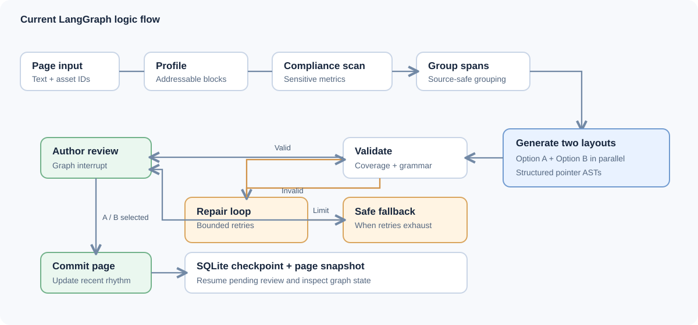

# AI-Powered Visual Book Generator: Technical Architecture & TDD Execution Plan

> **Document Purpose:** Canonical technical specification, Architecture Decision Record (ADR) log, data contract reference, and Test-Driven Development (TDD) execution plan. This document is structured to serve as the primary context source for human engineers and agentic coding assistants so every phase—from MVP demo to 500-page enterprise production—is built iteratively without rewrites.
>
> **Source Alignment:** Derived from `Product Summary_ AI-Powered Visual Book Generator.pdf` (PRD) and finalized architectural trade-off discussions.

---

## 1. Executive Summary & Problem Statement

### 1.1 Business Problem (PRD Sec. 1–3)
Internal marketing and content teams regularly produce large, content-heavy publications (up to **500 pages**). Converting raw text, photography, and data visualizations into visually polished book drafts currently requires heavy manual designer effort, multiple review cycles, and long turnaround times.

### 1.2 Product Objective
Build a browser-based, AI-powered typesetting platform that transforms raw page inputs (text + images) and optional book-level context into a visually cohesive, print-ready book draft. For every page, the system generates **two distinct, context-aware layout options**; the user selects the preferred layout and advances page-by-page (or reviews batches in later phases) until the book draft is complete.

### 1.3 Core Architectural Tension & Resolution
Two PRD success criteria create a deliberate engineering tension:
1. **"Produces visually reasonable and readable pages"** -> demands strict mathematical determinism, typography hygiene, and zero text/image overflow.
2. **"Demonstrates context-aware layout decisions (not just static templates)"** -> demands semantic understanding of text, visual understanding of images, tonal alignment with the book objective, and cross-page visual rhythm.

**Our Core Architectural Thesis:**
We resolve this tension through a **Constrained Design Grammar + Pointer-Based Layout AST**.
* The **AI Orchestration Engine** acts as an *Art Director*, making semantic and structural routing decisions (choosing grid archetypes, visual hierarchy, callout promotions, and image placements) within a strictly typed JSON schema.
* The **Deterministic Rendering & Validation Engine** acts as the *Typesetter*, enforcing fixed physical page dimensions, a 12-column CSS Grid, locked brand design tokens, zero-mutation text hydration, chart-crop protection, and DOM-level overflow guarantees.

### 1.4 PRD Success Criteria Mapped to Engineering KPIs

| PRD Success Criterion | Engineering KPI / Gate | Target |
| :--- | :--- | :--- |
| Significantly faster than manual typesetting | Median page generation latency (Option A + B parallel) | `< 6 seconds` (p95 `< 10s`) |
| Visually reasonable and readable pages | Zero-overflow rate (after deterministic auto-heal) | `100%` |
| Visually reasonable and readable pages | Text/Image drop or hallucination rate | `0%` (strict pointer assertion) |
| Context-aware (not static templates) | Consecutive duplicate archetype rate across a 20-page book | `0%` (sliding exclusion window) |
| Context-aware (not static templates) | Option A vs. Option B structural distinctness score | `100%` different archetype families |
| Handles up to ~500 pages within LLM limits | Token cost & context size per page as page count grows ($N \to 500$) | $O(1)$ constant context per page |

---

## 2. Architectural Research & Decision Records (ADRs)

This section documents all evaluated alternatives, pros/cons trade-offs, and finalized decisions so future contributors and coding agents do not revisit settled boundaries.

### ADR-001: Core Application Stack
* **Options Evaluated:**
  1. *Pure Client-Side (Vite + React + TS + Browser Gemini SDK):* Zero backend DevOps, fast PoC, native DOM math. **Rejected as foundation** because moving to 500-page bulk uploads, server-side PDF rendering, compliance scanning, and durable checkpoints would require a full backend rewrite.
  2. *Pure Python (LangGraph + Streamlit / Gradio):* Single runtime, strong AI orchestration. **Rejected** because Streamlit/Gradio cannot support precision desktop publishing grids, live DOM overflow measurement, or polished split-screen book editing without fragile raw HTML hacks.
  3. *Unified TypeScript (Next.js + Mastra + Vercel AI SDK):* Single language and shared Zod schemas end-to-end. **Strong alternative**, but weaker Python ecosystem for Phase 4 bulk enterprise document parsing (`.docx`, `.pdf`, `.pptx` via `Docling`/`PyMuPDF`/`Pillow`) and slightly less enterprise familiarity than LangGraph.
  4. *Google AI Studio Build Mode:* Fastest 1-day clickable sandbox. **Rejected** for production-extensible foundation due to prototyping sandbox limits.
  5. **SELECTED — Option A: React/Next.js (TypeScript + Tailwind CSS) Frontend + Python (FastAPI + LangGraph) Backend.**
* **Rationale:** Separates the *Visual Rendering Engine* (browser CSS Grid + React) from the *Stateful AI Orchestration Brain* (Python LangGraph) via a strict versioned JSON Layout AST. Gives best-in-class enterprise HITL checkpointing (`StateGraph`, `interrupt()`), parallel map-reduce (`Send()`), and native Python tooling for image inspection (`Pillow`), PDF merging (`pypdf`/`pikepdf`), PII/metrics scanning (`Presidio`), and future 500-page document ingestion (`Docling`).
* **Local Dev Ergonomics:** Runs locally with zero cloud DevOps using **SQLite** (LangGraph checkpointer + app DB) and **local filesystem storage** via adapter interfaces that swap cleanly to PostgreSQL and GCS/S3 in production.

### ADR-002: Deployment & Hosting Topology
* **Decision:** Host the **Next.js/React frontend on Vercel** (giving an edge-cached, snappy client-side editing experience) and deploy the **FastAPI + LangGraph + Playwright backend as a container on Google Cloud Run** (or local Docker Compose during demos).
* **Trade-Off Rationale:** Serverless functions (e.g., Vercel Functions) fight heavy ~300–500 MB Chromium binaries, long-running 500-page batch jobs, and persistent worker pools. Cloud Run provides container-native memory isolation, up to 60-minute request timeouts, scale-to-zero cost efficiency, and native IAM integration for Vertex AI.

### ADR-003: LLM Provider Strategy & Integration
* **Decision:** Use the official **`google-genai`** Python SDK wrapped behind an internal `LLMProvider` interface.
  * **Default Interactive Model:** `gemini-3.8-flash` (low latency, native multimodal vision for images/charts, strict JSON Structured Outputs).
  * **Escalation / Eval Model:** `gemini-3.1-pro` (used for offline VLM-as-a-Judge visual evals and optional complex layout repair).
  * **Performance Optimization:** Enable **Prompt Caching** on the static prefix (System Instructions + Design Grammar Spec + Book Design Tokens) to slash input latency and token costs across 500-page runs.
  * **Environment Switching:** Config-driven toggle between Gemini Developer API key (local dev / Google AI Pro included API credits) and **Vertex AI** (enterprise production with Zero Data Retention).

### ADR-004: Anti-Hallucination & Layout Representation (Pointer-Based AST)
* **Options Evaluated:**
  * *Raw HTML/CSS Generation:* High visual drift, broken print margins, unpredictable overflow, risk of LLM silently altering or omitting copy. **Rejected.**
  * *Rigid Fixed Templates (e.g., 5 hardcoded slots):* Reliable, but fails the PRD "context-aware, not static templates" criterion. **Rejected.**
  * **SELECTED — Constrained Design Grammar + Pointer-Based Layout AST.**
* **Anti-Hallucination Invariants:**
  1. **Zero Text Mutation:** Before invoking the LLM, raw page text is deterministically parsed into indexed atomic blocks (`p_01`, `p_02`, `list_01`, `h_01`) and images into asset IDs (`img_01`). The LLM outputs a layout AST referencing **IDs only**—never re-emitting body copy. The renderer hydrates exact user source strings.
  2. **Extractive-Only Callouts:** If the LLM promotes a pull quote or stat callout, it must supply the source `block_id` and an exact substring verified via deterministic check (`assert excerpt in source_blocks[block_id].text`).
  3. **100% Completeness Gate:** Deterministic validator asserts `set(input_block_ids) == set(placed_block_ids)` and `set(input_image_ids) == set(placed_image_ids)`. Zero silent drops allowed.

### ADR-005: PDF Export Engine & HTML-to-PDF Drift Control
* **Options Evaluated:**
  * *Client-Side (`window.print`, `html2canvas` + `jsPDF`, `Paged.js`):* Rasterized blurry/non-searchable PDFs (`html2canvas`), OS dialog inconsistencies (`window.print`), and browser OOM crashes at 500 pages. **Rejected for full book export** (keep `@media print` only as an instant single-page preview utility).
  * *Dual Rendering Stack (`Typst` / `WeasyPrint`):* Extremely fast compilation, but maintaining two layout engines (React/Tailwind in browser vs. Typst/WeasyPrint for PDF) guarantees visual drift. **Rejected.**
  * **SELECTED — Backend Headless Chromium (Playwright) in a Chunked Map-Merge Pipeline.**
* **Architecture & Drift Controls:**
  1. Render chunks of **10–25 pages** in isolated Playwright browser contexts concurrently to bound memory usage, then merge chunks and inject clickable PDF bookmarks/metadata using `pypdf`/`pikepdf`.
  2. **Structural Drift Prevention:** Bundle exact `.woff2` web fonts inside both frontend and container; enforce explicit physical CSS units (`210mm x 297mm` A4 or US Letter); require `document.fonts.ready` and eager image loading before `page.pdf()`; maintain a 5–8% vertical safety buffer.
  3. **Automated Post-Export PDF Gate:** Assert in Playwright that `scrollHeight <= clientHeight` per page container; post-render, verify via `pypdf` that `physical_pdf_page_count == expected_logical_page_count` (catches OS font-hinting 1-line spillovers immediately).

### ADR-006: Context-Aware Parallelism Without Visual Repetition
* **Problem:** Sequential LLM generation is too slow for bulk 500-page runs, while naive parallel generation causes adjacent pages to pick identical layouts.
* **Decision:**
  * **Interactive Mode (MVP):** Generate Option A and Option B in **parallel** per page (halving latency) using two distinct editorial strategy directives, while passing a **Rolling Exclusion Window** of the last 3–5 selected page archetypes.
  * **Bulk Mode (Phase 4):** **Two-Phase Planner-Worker Graph** using LangGraph's `Send()` fan-out API:
    1. *Phase 1 (Fast Sequential Rhythm Planner):* Inspects a lightweight metadata manifest (word counts, image counts/ratios, chapter markers) for a 10–20 page batch and assigns non-overlapping allowed archetype sets per page.
    2. *Phase 2 (Parallel Workers):* Fans out page generation concurrently within those pre-de-duplicated archetype constraints.

### ADR-007: Global Style Consistency, Brand Extraction & Master Chrome
* **Global Style Consistency:** Book creation locks a single immutable `DesignTokens` JSON object mapped to CSS Custom Properties (`--brand-primary`, `--brand-accent`, `--surface-tint`, `--font-heading`, `--font-body`, `--radius-base`, `--page-margin`). The LLM only selects **semantic style roles** (never raw hex codes or pixel sizes).
* **Website Theme Extraction + Manual Override (Phase 2):** Optional input of a company website URL fetched server-side with **SSRF protection** (blocking private/loopback/metadata IP ranges). Extracts `<meta name="theme-color">`, CSS variables, and dominant header/logo colors, passes them through a **WCAG AA Contrast Sanitizer**, and presents editable color swatches + curated editorial presets before Page 1 generation.
* **Global Headers & Footers (`MasterChromeConfig`):** Optional book-level master template (Left / Center / Right slots supporting static text like copyright notices and dynamic variables `{page_number}`, `{total_pages}`, `{chapter_title}`). Carves out a fixed reserved safe zone (`12mm` top/bottom) outside the AI layout grid and auto-suppresses chrome on `cover`, `section_divider`, and `full_bleed_hero` pages.

### ADR-008: Metrics Isolation & Compliance / Data Security (Phase 2)
* **Problem:** Marketing drafts often contain internal KPIs, draft projections, or `[CONFIDENTIAL]` / `[UNDISCLOSED]` metrics that must never be accidentally elevated into a giant hero `StatCallout` in a client-facing book.
* **Decision:** Integrate a deterministic **Compliance & Metrics Isolation Node** inside content profiling:
  1. Extract numeric claims (`$`, `%`, YoY, ARR, headcount) and sensitivity tags (`[INTERNAL]`, `[CONFIDENTIAL]`, `[UNDISCLOSED]`, `[DRAFT]`) via Regex + NER (`Presidio`).
  2. Maintain a typed `MetricsLedger` (`public` | `internal` | `undisclosed` | `unverified`) evaluated against book `AudienceMode` (`internal` vs. `client_facing`).
  3. **Hard Guardrail:** Any non-`public` metric in `client_facing` mode is strictly barred from `StatCallout` promotion, optionally masked as `[METRIC_01]` before external LLM calls (strict privacy mode), and triggers a mandatory UI compliance sign-off/redaction gate prior to PDF export.

### ADR-009: Pre-Export Structural Assembly (Phase 2)
* **Decision:** Decouple structural book elements from the body-page loop using a 3-section book model:
  * `front_matter[]`: Cover Page, Legal/Imprint, Preface, and auto-generated **Table of Contents (ToC)**.
  * `body_pages[]`: User-created pages + optional auto-inserted `SectionDivider` pages based on chapter tags.
  * `back_matter[]`: Appendix / Closing Cover.
* **Why Pre-Export?** Final page numbering is only stable after body pages are added, reordered, or deleted. Generating the ToC deterministically at assembly time enables accurate page numbers and clickable internal HTML anchors (`#page-N`) preserved by Playwright in the exported PDF.

### ADR-010: Session-Based Generation & Checkpointing
* **Decision:** Every book project is a durable **Session** backed by LangGraph's `thread_id` checkpointer + versioned page snapshots. Supports pause/resume across days, page revisit/re-generation, theme branching, and deterministic state replay for debugging.

---

## 3. LangGraph Topology



| Node | Execution Type | Responsibility |
| :--- | :--- | :--- |
| `profile_content` | Deterministic Python | Splits raw text into indexed atomic blocks; computes word/character counts; extracts image pixel dimensions, aspect ratios, DPI (`Pillow`), and classifies `photo` vs `chart`. |
| `compliance_metrics_scan` | Deterministic Python | Extracts numeric claims and sensitivity tags; updates `MetricsLedger`; flags restricted metrics so they cannot be promoted to `StatCallout`. |
| `generate_candidates` | Parallel LLM (`asyncio` / LangGraph fan-out) | Runs two concurrent structured-output calls: **Option A** (*Editorial / Visual-First*) and **Option B** (*Executive / Structured-First*), enforcing distinct archetype subsets. |
| `deterministic_validator` | Deterministic Python | Runs fast (<10ms) invariants: schema check, 100% block/image ID completeness, extractive quote verification, chart crop-ban (`object-contain`), slot character-budget estimation, and A vs. B distinctness check. |
| `critic_and_repair` | Conditional LLM (Max 2 loops) | Invoked **only** when `deterministic_validator` fails. Receives exact structured error traces (e.g., `"Option B omitted img_02 and exceeded slot_main budget by 18%"`) and emits a repaired AST. |
| `safe_fallback_builder` | Deterministic Python | Zero-failure safety net if retries exhaust: deterministically places all blocks and images into a guaranteed-readable multi-column fallback layout so the user is never blocked. |
| `human_review_interrupt` | LangGraph `interrupt()` | Persists state to checkpointer, streams Option A + B JSON ASTs + rationales to the frontend, and suspends execution until the user picks an option (or triggers a Phase 3 natural-language refinement). |
| `commit_page` | Deterministic Python | Saves the chosen `PageLayoutAST` snapshot, appends its archetype to `rolling_layout_history`, and increments `current_page_index`. |

---

## 4. Repository Structure (Monorepo)

```text
visual-book-generator/
├── ARCHITECTURE_AND_TDD_PLAN.md    # This document (agent context)
├── Makefile                        # Unified dev, test, lint, typegen, export commands
├── docker-compose.yml              # Local full-stack + Playwright container (optional)
├── config/                         # DECOUPLED CONFIGURATION (No magic strings in code)
│   ├── app.default.yaml            # Storage adapters, DB URI, feature flags, CORS
│   ├── models.yaml                 # Model IDs, temps, retries, prompt-cache TTL
│   ├── design_grammar.yaml         # Archetype constraints (word budgets, slots, image rules)
│   ├── compliance.yaml             # Regex patterns, sensitivity tags, audience policies
│   └── prompts/                    # Versioned Jinja2/YAML prompt templates
│       ├── system_art_director.yaml
│       ├── strategy_option_a.yaml
│       ├── strategy_option_b.yaml
│       └── critic_repair.yaml
├── apps/
│   ├── api/                        # Python 3.12+ / FastAPI / LangGraph
│   │   ├── pyproject.toml
│   │   ├── src/bookgen/
│   │   │   ├── main.py             # FastAPI entrypoint + lifespan wiring
│   │   │   ├── config/             # Pydantic-settings + YAML loader
│   │   │   ├── schemas/            # Canonical Pydantic v2 Data Contracts
│   │   │   ├── adapters/           # Protocol interfaces + implementations
│   │   │   │   ├── llm/            # GeminiProvider, MockLLMProvider
│   │   │   │   ├── storage/        # LocalFSStorage, GCSStorage
│   │   │   │   ├── db/             # SQLiteRepo, PostgresRepo
│   │   │   │   └── pdf/            # PlaywrightChunkExporter
│   │   │   ├── domain/             # Pure deterministic business logic (100% unit-testable)
│   │   │   │   ├── profiler.py     # Text parser, Pillow image metrics, chart classifier
│   │   │   │   ├── compliance.py   # Metrics isolation & sensitivity gate
│   │   │   │   ├── validator.py    # Schema, pointer completeness, budget, crop & distinctness checks
│   │   │   │   ├── fallback.py     # Deterministic safe layout builder
│   │   │   │   ├── theme.py        # SSRF-safe URL theme extractor + WCAG contrast sanitizer
│   │   │   │   └── assembler.py    # Front matter, ToC, Section Dividers, numbering
│   │   │   ├── graph/              # LangGraph StateGraph, nodes, edges, checkpointer
│   │   │   ├── routes/             # REST + SSE endpoints
│   │   │   └── telemetry/          # OpenTelemetry + Langfuse hooks
│   │   └── tests/
│   │       ├── unit/               # Pure domain & validator tests
│   │       ├── graph/              # LangGraph execution tests with MockLLMProvider
│   │       ├── integration/        # FastAPI + SQLite + Playwright PDF drift tests
│   │       └── golden/             # 25-30 edge-case page fixtures for offline evals
│   └── web/                        # Next.js (App Router) + React + TypeScript + Tailwind
│       ├── package.json
│       ├── src/
│       │   ├── types/generated.ts  # Auto-generated from FastAPI OpenAPI schema
│       │   ├── config/env.ts       # Typed frontend env config
│       │   ├── engine/             # Deterministic Layout Renderer
│       │   │   ├── PageCanvas.tsx  # Physical A4/Letter container + MasterChrome
│       │   │   ├── archetypes/     # 1 React Grid component per LayoutArchetype
│       │   │   ├── blocks/         # Heading, Prose, ImageFrame, PullQuote, StatCallout
│       │   │   └── useOverflowHeal.ts # DOM scrollHeight <= clientHeight auto-healer
│       │   ├── components/         # Setup wizard, Side-by-Side A/B selector, Virtualized rail
│       │   └── app/                # App Router pages + /print/[sessionId] route for Playwright
│       └── tests/
│           ├── unit/               # Vitest renderer & overflow heal tests
│           └── e2e/                # Playwright visual + export parity tests
└── scripts/
    └── sync_contracts.sh           # Exports OpenAPI JSON -> generates web/src/types/generated.ts
```

## 5. Decoupled Delivery Roadmap (MVP vs. Phase-Wise Iterations)

Every phase directly maps to `Product Summary_ AI-Powered Visual Book Generator.pdf` while ensuring zero throwaway code between phases.

| Phase | PRD Alignment | Scope Delivered | Architecture Plug-In Mechanism |
| :--- | :--- | :--- | :--- |
| **Phase 0: Foundation** | Engineering Enabler | Monorepo scaffold, decoupled YAML config loader, Pydantic v2 Data Contracts, OpenAPI -> TS typegen, CI test runner, Storage/LLM Protocol adapters (SQLite + LocalFS + MockLLM). | Establishes the versioned AST seam & TDD harness. |
| **Phase 1: Core MVP** | **PRD Sec. 4, 5, 8, 10** (MVP Scope & Deliverables) | Browser studio; optional Book Context (Title, Objective); page-by-page Text + Image upload; LangGraph 5-stage pipeline (`profile -> parallel A/B gen -> deterministic validator -> conditional repair -> HITL interrupt -> commit`); rolling 3-page anti-repetition memory; 8 composable React/Tailwind archetypes; AI Layout Rationale badge; DOM overflow auto-heal; session persistence (SQLite); complete book draft viewer + basic browser print view. | Delivers 100% of PRD MVP + deterministic quality gates, ready for local demo or Vercel/Cloud Run deploy. |
| **Phase 2: Production Publishing & Compliance** | Enterprise Readiness & Quality Hardening | Backend chunked **Playwright PDF Export** + `pypdf` merge + **PDF Drift Validation Gate**; Website URL theme extraction (SSRF-safe + WCAG sanitizer) & manual brand color pickers; Global `MasterChromeConfig` (optional headers/footers/page numbers); **Metrics Isolation & Compliance Gate**; Pre-Export Assembly (**Cover, Preface, Section Dividers, clickable ToC**). | Adds new deterministic nodes & pre-export assembler around the unchanged Phase 1 `PageLayoutAST`. |
| **Phase 3: Interactive Editing & Themes** | **PRD Sec. 7** (Future Enhancements: NL/UI edits, Save/Revisit, Themes) | Natural-language page editing (*"make image larger and pull out the 3x ROI quote"*) via a `refine_page` LangGraph branch; full page revisit/reorder/time-travel UI; curated multi-theme preset library (live theme swap with zero LLM re-runs); light UI slot-swap controls. | Extends `human_review_interrupt` with an edit loop and swaps `DesignTokens`. |
| **Phase 4: 500-Page Bulk Scale & LLMOps** | **PRD Sec. 7 & 8** (Bulk Upload & ~500-Page Scale) | Bulk `.docx` / `.pdf` / `.pptx` ingestion (`Docling`/`PyMuPDF`) with semantic page chunking; **Two-Phase Planner-Worker** parallel batch generation (LangGraph `Send()` fan-out + async worker queue); **Virtualized 500-page UI rail** (`TanStack Virtual`); PostgreSQL + GCS/S3 adapter activation; Langfuse observability + CI Golden VLM Eval suite. | Activates cloud adapters via config YAML and plugs `chunk_document` + `rhythm_planner` upstream of the existing worker graph. |

---

## 6. Agentic Coding Guardrails (Strict Invariants)

Any AI coding assistant implementing tasks from this specification MUST obey these non-negotiable rules:

1. **NEVER allow an LLM to generate raw HTML, raw CSS, hex colors, or pixel margins.** All layouts must be emitted as `PageLayoutAST` validated by Pydantic v2 and rendered via semantic Tailwind/CSS-variable components.
2. **NEVER allow an LLM to rewrite or re-emit user body copy.** Always route via `source_block_ids` pointers; validate any `extracted_excerpt` via exact substring assertion.
3. **NEVER apply `object-cover` cropping or text overlays to `CHART` or `DIAGRAM` assets.** Enforce `object-contain` both in the backend validator and frontend `ImageFrame` component.
4. **NEVER hardcode model identifiers, prompts, word budgets, or compliance regexes in Python/TypeScript logic.** Load all parameters from `/config/*.yaml`.
5. **NEVER mutate Pydantic schemas without running `make sync-contracts`** to regenerate `apps/web/src/types/generated.ts`.
6. **NEVER write production logic before writing and executing the corresponding failing test** for the active sprint task.
7. **NEVER send raw full-resolution images or full 500-page history to the LLM.** Always transmit downscaled thumbnails (`<= 768px`) and the bounded 3-slice hierarchical context.