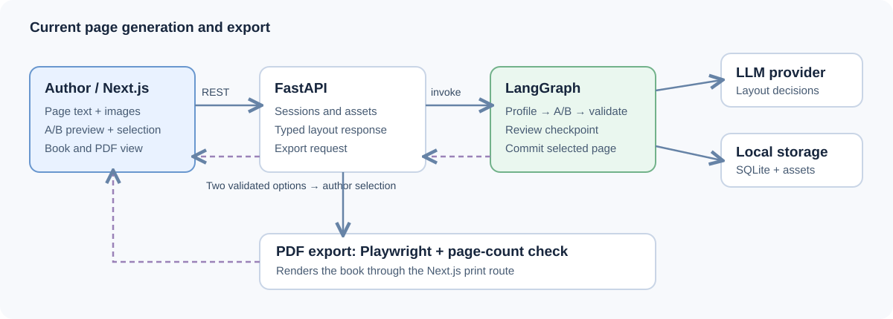
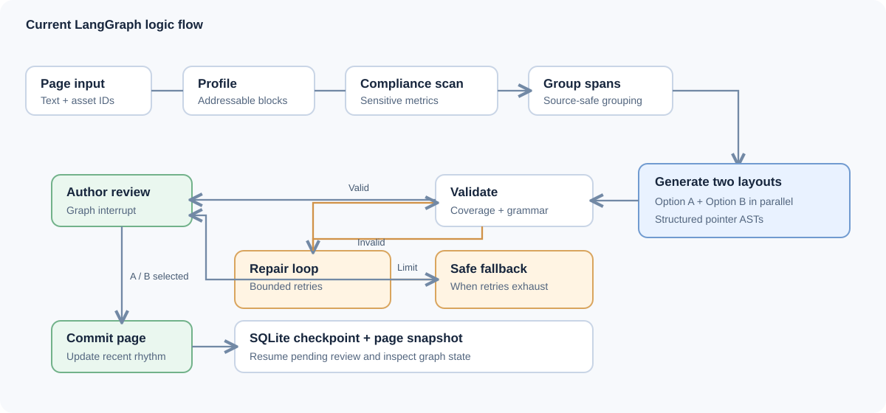

# Visual Book Generator: Approach, Assumptions, Trade-offs, and Next Steps

**Purpose.** Turn supplied page text and images into a consistent, reviewable book draft while preserving the client's original copy. The current product generates two layout choices per page; the author selects one before the next page is committed.

## Approach

| Decision | Current approach | Why it matters |
| --- | --- | --- |
| Book-wide style | A shared theme and semantic design tokens govern all page rendering. Theme selection and appearance settings have an initial implementation; a reusable template library does not. | Keeps typography and colors consistent without asking the model to invent styling per page. |
| Page generation | FastAPI runs a LangGraph workflow that produces two structured layout options, checks them, and pauses for author selection. | Keeps AI choices reviewable and makes validation a required step. |
| Source integrity | The model references source block and image IDs in a constrained `PageLayoutAST`; React renders the stored source text. | Prevents the layout step from rewriting client copy and supports deterministic rendering. |
| Continuity | Sessions, page snapshots, assets, and graph checkpoints use SQLite and local files in the current build. A node-by-node debugger exposes graph state. | Supports local resume and diagnosis; production-grade durable storage remains to be built. |

The browser sends a page-sized input to the API. Profiling and span grouping prepare addressable text blocks; compliance checks flag sensitive metrics. Two layout strategies run concurrently, then deterministic checks enforce source coverage, layout rules, and image treatment. Invalid options enter a bounded repair loop or a safe fallback. The graph checkpoints at author review; selection commits the page and updates a small recent-layout history. PDF export uses the same rendered book pages through Playwright, followed by page-count checks.

## Assumptions

| Assumption | Consequence |
| --- | --- |
| The client supplies accurate, cleared text and images. | Editorial fact-checking and visual-content sanity remain the client's responsibility; structural and compliance checks still run. |
| MVP input is already divided into page-level text and image sets. | The service can profile and group text within a page, but full document ingestion and automatic page segmentation are outside this flow. |
| A paid, highly available LLM API plan is available. | Generation latency and availability still depend on the provider; deterministic fallback covers invalid layouts, not every provider outage. |
| Duplicate page content is managed upstream. | Recent layout history limits visual repetition, but no content-based duplicate-page detector prevents the same page from being generated twice. |

## Trade-offs

| Choice | Benefit | Cost or boundary |
| --- | --- | --- |
| Constrained design grammar and pointer-based AST instead of model-written HTML/CSS | Predictable rendering, exact source copy, testable rules, and a design that can support theme swaps without new LLM calls. | Visual range is limited to encoded archetypes. Theme changes after generation are not yet exposed as a complete product flow. |
| Addressable source blocks | Every layout element can be traced to its source. | Poor upstream segmentation can produce awkward layouts; the layout model cannot freely merge or split copy. |
| Shared tokens and initial themes | Reliable book-wide style with fewer per-page decisions. | More theme refinement and a template store are needed for distinctive editorial work. |
| SQLite and local assets | Simple development, checkpoint recovery, and debugging. | Instance-local storage is insufficient for durable, multi-instance production use. |

## Future Enhancements

| Priority | Enhancement | Expected value |
| --- | --- | --- |
| 1 | Add page editing and a fuller theme/template library, including post-generation theme switching. | Better control of finished pages and broader visual variety without re-generating source content. |
| 2 | Add a document parser and content-level duplicate detection. | Better block boundaries and fewer accidental duplicate pages in bulk jobs. |
| 3 | Enable bulk upload with page-tagged text/image sets, a lightweight rhythm-planning pass, and parallel LangGraph page workers. | The existing page-level AST, validation, and independent checkpoints can be reused; preassigned archetypes reduce repeated layouts before workers run concurrently. |
| 4 | Estimate remaining page capacity from text spans, image ratios, and rendered overflow measurements. | Earlier warnings and more reliable layout choices. |
| 5 | Tune prompts and token budgets; offer controlled image restyling, especially for chart accent and background colors while preserving data and legibility. | Lower generation cost and stronger visual cohesion. |

*Basis: [Technical Architecture and TDD Execution Plan](ai_powered_visual_book_generator_technical_architecture_tdd_execution_plan.md) and the current implementation. Future items are proposed capabilities.*
